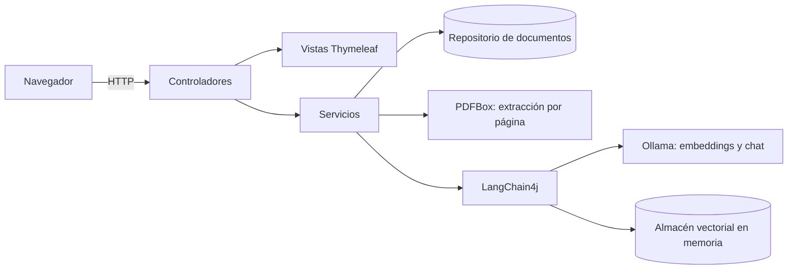

# Asistente documental con RAG

Aplicación web en Java que permite subir manuales, fichas técnicas o procedimientos en PDF y hacerles preguntas en lenguaje natural. Las respuestas se generan con un modelo de lenguaje local (Ollama) a partir de los fragmentos más relevantes de los documentos, y cada una indica el archivo y la página de donde salió la información.

*English summary at the end.*

## Características

- Carga de PDF con validación de formato, tamaño y contenido (detecta archivos dañados, protegidos o escaneados sin OCR).
- Extracción de texto página por página para citar la ubicación exacta de cada fuente.
- Fragmentación recursiva con solapamiento y embeddings por lotes.
- Búsqueda semántica en todos los documentos o en uno específico.
- Respuestas con citas numeradas `[1]`, `[2]` vinculadas a archivo, página, extracto y relevancia.
- Protección contra respuestas inventadas: si no hay contexto relevante, no se llama al LLM.
- Funciona 100 % local y sin costo: no requiere API keys ni envía datos a terceros.
- Interfaz web responsiva con Thymeleaf, historial de conversación por sesión.
- Pruebas unitarias y de controlador con JUnit 5, Mockito y MockMvc.

## Arquitectura

El proyecto sigue el patrón MVC organizado por capas:



```
src/main/java/com/wilsonleal/ragassistant
├── RagAssistantApplication.java     Punto de entrada
├── config/
│   ├── AiConfig.java                Beans de IA: ChatModel, EmbeddingModel, EmbeddingStore, splitter
│   └── RagProperties.java           Configuración tipada y validada (prefijo rag)
├── controller/                      Capa de control (C)
│   ├── ChatController.java          Preguntas y conversación
│   ├── DocumentController.java      Subir, listar y eliminar documentos
│   └── GlobalExceptionHandler.java  Errores convertidos en mensajes claros
├── dto/
│   └── QuestionForm.java            Formulario validado de la pregunta
├── exception/                       Excepciones de dominio
├── model/                           Modelo (M): records inmutables
│   ├── ChatAnswer.java
│   ├── DocumentInfo.java
│   ├── PageText.java
│   ├── PdfContent.java
│   ├── RetrievedChunk.java
│   └── SourceReference.java
├── repository/
│   └── DocumentRepository.java      Registro en memoria, seguro para concurrencia
└── service/                         Lógica de negocio
    ├── DocumentIngestionService.java   Validar, extraer, fragmentar, indexar
    ├── PdfTextExtractor.java           Lectura de PDF con PDFBox
    ├── PromptBuilder.java              Construcción del prompt
    ├── QuestionAnsweringService.java   Pipeline RAG
    └── SegmentMetadata.java            Claves de metadatos

src/main/resources
├── application.yml                  Configuración
├── templates/                       Vistas (V): chat, documentos, error y fragmentos
└── static/                          CSS y JavaScript
```

### Flujo RAG

1. **Indexación.** El PDF se valida y se extrae página por página. Cada página se divide en fragmentos de hasta 800 caracteres con 120 de solapamiento, y cada fragmento guarda como metadatos el documento, el archivo y la página.
2. **Embeddings.** Los fragmentos se convierten en vectores con `nomic-embed-text` y se guardan en el almacén vectorial.
3. **Recuperación.** La pregunta se convierte en vector y se buscan los cinco fragmentos más similares por similitud coseno, filtrando por documento si se eligió uno.
4. **Generación.** Si hay fragmentos con relevancia suficiente, se construye un prompt con ese contexto numerado y `llama3.2` genera la respuesta citando las fuentes.

## Requisitos

- Java 21
- Maven 3.9 o superior
- [Ollama](https://ollama.com) instalado y en ejecución

## Instalación y ejecución

1. Descarga los modelos en Ollama:

   ```bash
   ollama pull llama3.2
   ollama pull nomic-embed-text
   ```

2. Compila y ejecuta la aplicación:

   ```bash
   mvn spring-boot:run
   ```

3. Abre `http://localhost:8080`, sube un PDF en **Documentos** y empieza a preguntar.

Si prefieres no instalar Maven, genera el wrapper una vez con `mvn wrapper:wrapper` y luego usa `./mvnw spring-boot:run`.

### Con Docker

```bash
docker compose up -d --build
docker compose exec ollama ollama pull llama3.2
docker compose exec ollama ollama pull nomic-embed-text
```

La aplicación queda disponible en `http://localhost:8080`.

## Configuración

Todos los valores se pueden cambiar en `application.yml` o con variables de entorno:

| Propiedad | Variable de entorno | Valor por defecto | Descripción |
|---|---|---|---|
| `rag.ollama.base-url` | `OLLAMA_BASE_URL` | `http://localhost:11434` | URL de Ollama |
| `rag.ollama.chat-model` | `OLLAMA_CHAT_MODEL` | `llama3.2` | Modelo que genera las respuestas |
| `rag.ollama.embedding-model` | `OLLAMA_EMBEDDING_MODEL` | `nomic-embed-text` | Modelo de embeddings |
| `rag.ingestion.chunk-size` | | `800` | Tamaño máximo del fragmento, en caracteres |
| `rag.ingestion.chunk-overlap` | | `120` | Solapamiento entre fragmentos |
| `rag.retrieval.max-results` | | `5` | Fragmentos enviados como contexto |
| `rag.retrieval.min-score` | | `0.6` | Relevancia mínima (0 a 1) |

Para respuestas de mayor calidad puedes usar un modelo más grande, por ejemplo `OLLAMA_CHAT_MODEL=llama3.1:8b`, si tu equipo tiene memoria suficiente.

## Pruebas

```bash
mvn test
```

Las pruebas cubren la construcción del prompt, la extracción de PDF (con documentos generados en memoria), el pipeline RAG con modelos simulados, el repositorio y el controlador web.

## Decisiones técnicas

- **LangChain4j en lugar de llamadas HTTP directas:** abstrae el proveedor de IA y el almacén vectorial detrás de interfaces. Cambiar Ollama por OpenAI o el almacén en memoria por pgvector solo afecta a `AiConfig`.
- **PDFBox directo en lugar del parser de LangChain4j:** permite extraer por página y conservar el número de página en los metadatos.
- **No llamar al LLM sin contexto:** reduce las alucinaciones y el tiempo de respuesta cuando la pregunta no tiene relación con los documentos.
- **Records inmutables para el modelo:** menos código repetitivo y datos seguros para compartir entre hilos.

## Limitaciones y hoja de ruta

- [ ] Persistencia: hoy los documentos y embeddings viven en memoria y se pierden al reiniciar. Siguiente paso: PostgreSQL con pgvector.
- [ ] Procesamiento asíncrono de documentos grandes con barra de progreso.
- [ ] Respuestas en streaming.
- [ ] OCR para PDF escaneados (Tesseract).
- [ ] Reordenamiento de resultados (re-ranking) y búsqueda híbrida.
- [ ] Autenticación y documentos por usuario.

## Licencia

MIT. Consulta el archivo [LICENSE](LICENSE).

---

## English summary

**RAG Document Assistant** is a Spring Boot web application that lets you upload PDF manuals and technical sheets and ask questions about them in natural language. It runs fully locally with Ollama (`llama3.2` for chat, `nomic-embed-text` for embeddings), uses LangChain4j for the RAG pipeline and an in-memory vector store, and extracts text page by page with Apache PDFBox so every answer cites the source file and page.

**Stack:** Java 21, Spring Boot 3, Thymeleaf, LangChain4j, Ollama, Apache PDFBox, JUnit 5, Mockito, Docker.

**Run it:** `ollama pull llama3.2 && ollama pull nomic-embed-text`, then `mvn spring-boot:run` and open `http://localhost:8080`.
